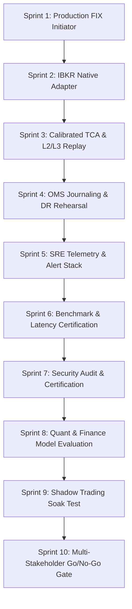

# DELTA OS — Institutional P0 Certification Sprint Plan

> **DECISION: 🔴 NO-GO FOR LIVE TRADING**
> **STATUS**: Research-grade quantitative trading platform with robust architecture, fail-closed safety, temporal integrity, and high-performance Rust TUI, but **not yet certified for live capital deployment**.

---

## 1. Executive Summary & Maturity Model

In accordance with DELTA OS institutional release standards, a capability is **not claimed** until **implementation + tests + failure handling + telemetry + deterministic behavior + ownership** are all verified and certified.

Feature additions are halted in favor of a **P0 Certification Sprint** structured around the 13-stage Institutional Maturity Model:

```
                          DELTA MATURITY MODEL
                          
DESIGNED ──► IMPLEMENTED ──► UNIT TESTED ──► INTEGRATION TESTED ──► FAILURE TESTED
   ▲
   │
PROD ◄── CERTIFIED ◄── SHADOW ◄── REPRODUCIBLE ◄── SECURITY VALID ◄── OBSERVABLE ◄── PIT VALID
```

---

## 2. Phase-1 Go/No-Go Gate Assessment

| Gate Domain | Target Criteria | Current Status | Evidence / Gap | Decision |
| :--- | :--- | :---: | :--- | :---: |
| **1. Scope & Deliverables** | Zero uncertified P0/P1 production backlogs | 🟡 Partial | Production FIX, IBKR, & TCA uncertified | **FAIL** |
| **2. Functional E2E/UAT** | End-to-end broker lifecycle & reconciliation | 🟡 Partial | 12-stage pipeline complete; live broker session stubbed | **FAIL** |
| **3. Performance & Stress** | Order book 10M ops/s, Risk firewall < 7µs | 🔴 Unmeasured | Microbenchmarks exist; 10M tick/sec stress uncertified | **FAIL** |
| **4. Security & Compliance** | SAST/DAST, RBAC, secret rotation, audit ledger | 🟡 Partial | Fail-closed & SHA-256 ledger built; formal cert pending | **FAIL** |
| **5. Cutover / DR / Rollback** | Rehearsed state recovery, journaled OMS, RTO<5m | 🔴 Unproven | OMS state machine exists; DR rehearsal unproven | **FAIL** |
| **6. Observability & SRE** | Prometheus metrics + Grafana + alerting rules | 🟡 Partial | Exporter complete; operational alerts/wiring pending | **FAIL** |
| **7. Stakeholder Sign-off** | Formal sign-off (Quant, Eng, Risk, Ops, Sec) | 🔴 Missing | Formal Go/No-Go matrix unexecuted | **FAIL** |
| **OVERALL GATE** | **All 7 gates MUST pass unconditionally** | 🔴 **RED** | **Production Live Trading Switch Locked** | **NO-GO** |

---

## 3. P0 Certification Sprints & Execution Roadmap



---

### Sprint 1: Production FIX 4.2 / 4.4 Initiator Engine
* **Target Subsystem**: `execution/sor_venue.py` & `execution/fix/`
* **Objective**: Complete production-grade FIX session lifecycle and state machine recovery.

#### Deliverables & Implementation Workflow
1. **Full Protocol Lifecycle**:
   - `TCP/TLS` connection management with TLS 1.3 mutual auth.
   - `Logon (MsgType A)`, `Heartbeat (0)`, `TestRequest (1)`, `Logout (5)`.
   - `NewOrderSingle (D)`, `ExecutionReport (8)`, `OrderCancelReplaceRequest (G)`, `OrderCancelRequest (F)`, `OrderCancelReject (9)`.
2. **Sequence Persistence & Gap Recovery**:
   - SQLite/MMap-backed sequence store with `MsgSeqNum` tracking.
   - Automatic `ResendRequest (2)` handling upon sequence gap detection.
   - `SequenceReset (4)` with `GapFillFlag (Y)` processing.
3. **Certification Suite**:
   - Automated mock FIX acceptor test suite simulating network drops, out-of-order sequence numbers, partial fills, and abrupt session disconnects.

---

### Sprint 2: IBKR Broker Adapter & Contract Resolution
* **Target Subsystem**: `delta_os/brokers.py` & `execution/adapters/ibkr.py`
* **Objective**: Replace disabled stub path with institutional Interactive Brokers TWS/Gateway API adapter.

#### Deliverables & Implementation Workflow
1. **Connection & Authentication Lifecycle**:
   - Asynchronous client connection to IB Gateway / TWS API over TLS.
   - Automatic re-authentication and session heartbeat monitor.
2. **Contract Resolution & Order Operations**:
   - Symbol to IBKR `Contract` mapping (ConId, SecType, Exchange, PrimaryExchange, Currency).
   - Order mapping: `Submit`, `Cancel`, `Modify` (Replace), and execution tracking.
3. **Reconciliation & State Sync**:
   - Account summary, cash balances, open positions, and working orders synchronization.
   - Three-way real-time reconciliation (Local OMS vs IBKR Gateway vs Ledger).

---

### Sprint 3: Calibrated TCA & L2/L3 Historical Event Replay Engine
* **Target Subsystem**: `execution/cost_engine.py` & `simulation/replay.py`
* **Objective**: Calibrate transaction cost analysis (TCA) and construct high-fidelity L2/L3 market data replay.

#### Deliverables & Implementation Workflow
1. **Implementation Shortfall (IS) Decomposition**:
   $$\text{IS} = \text{ExecutionCost} + \text{OpportunityCost}$$
   $$\text{IS} = \text{Spread} + \text{Fees} + \text{Slippage} + \text{MarketImpact} + \text{TimingCost} + \text{DelayCost}$$
2. **Empirical Impact Model Calibration**:
   - Calibrate square-root market impact parameter $\gamma$ against historical tick/order book data:
     $$\Delta P = \gamma \cdot \sigma \cdot \sqrt{\frac{V_{\text{order}}}{V_{\text{ADV}}}}$$
3. **L2/L3 Queue & Replay Simulator**:
   - Replay tick-by-tick order book updates with FIFO queue position tracking for limit order fill probabilities.

---

### Sprint 4: OMS Journaled Recovery & Disaster Recovery (DR) Rehearsal
* **Target Subsystem**: `execution/reconciliation/` & `core/canonical_pipeline.py`
* **Objective**: Ensure 100% deterministic OMS state reconstruction after abrupt system termination.

#### Deliverables & Implementation Workflow
1. **Write-Ahead Order Journal**:
   - Append-only MMap order state journal recording every state transition (`CREATED` $\to$ `VALIDATED` $\to$ `RISK_APPROVED` $\to$ `SUBMITTED` $\to$ `ACKNOWLEDGED` $\to$ `FILLED`).
2. **Crash & Recovery Protocol**:
   - Simulate hard `kill -9` process termination mid-execution.
   - On reboot: Journal replay $\to$ Snapshot load $\to$ Broker state poll $\to$ Three-way reconciliation $\to$ State resolution.
3. **DR Metrics**:
   - Measure **RTO** (Recovery Time Objective < 60s) and **RPO** (Recovery Point Objective = 0 data loss).

---

### Sprint 5: Production SRE Telemetry, Prometheus & Grafana Stack
* **Target Subsystem**: `observability/exporter.py` & `monitoring/`
* **Objective**: Wire operational metrics, alert rules, and Grafana dashboards.

#### Deliverables & Implementation Workflow
1. **Prometheus Metrics Suite**:
   - **Market Telemetry**: `feed_latency_nanoseconds`, `sequence_gap_count`, `stale_symbol_flag`.
   - **Execution Telemetry**: `order_to_ack_latency_ms`, `ack_to_fill_latency_ms`, `order_reject_rate`.
   - **Risk Telemetry**: `risk_eval_latency_ns`, `kill_switch_state`, `limit_breach_total`.
   - **AI/Agent Telemetry**: `llm_ttft_ms`, `tool_call_latency_ms`, `agent_budget_exhausted_total`.
2. **Grafana Dashboards & Alert Rules**:
   - Configure operational alert thresholds (PagerDuty / Slack integration hooks).

---

### Sprint 6: Empirical Benchmarking & Throughput Certification
* **Target Subsystem**: `native/`, `tui/`, & `benchmarks/`
* **Objective**: Measure and publish reproducible performance metrics across Python, C++, and Rust modules.

#### Benchmark Protocol Specification
* **Hardware Standard**: Isolated physical core, CPU affinity locked, Turbo Boost disabled.
* **Metrics Captured**: p50, p95, p99, p99.9, Max Latency, ops/sec.

| Component | Target Throughput | Benchmark Plan | Certification Standard |
| :--- | :---: | :--- | :---: |
| **Limit Order Book (LOB)** | 10,000,000 ops/s | MMap 100M tick synthetic & historical replay | Differential Python vs Rust vs C++ |
| **Matching Engine** | 10,000,000 ops/s | Multi-threaded limit/market order cross | Microsecond-accurate latency distribution |
| **Rust TUI Event Queue** | 5,000,000 ops/s | Channel throughput & frame render loop | Zero frame drop under high tick load |
| **Risk Firewall** | < 7 µs per order | In-memory pre-trade pre-network checks | Deterministic rejection latency |

---

### Sprint 7: Production Security Certification & SAST/DAST Audit
* **Target Subsystem**: `governance/` & `security/`
* **Objective**: Complete formal security auditing, secret rotation, and role-based access control (RBAC).

#### Deliverables & Implementation Workflow
1. **Static & Dynamic Analysis (SAST/DAST)**:
   - Automated Semgrep, Bandit, and Cargo Audit vulnerability scanning in CI/CD.
2. **Secret Vault & Rotation**:
   - AES-256-GCM encrypted credential vault with key rotation protocols.
3. **Role-Based Access Control**:
   - Verification of operator privileges (`DELTA_UNLOCK_TOKEN` required for HALTED state unlocks).
4. **Tamper-Evident Event Ledger**:
   - SHA-256 chain validation on all trade, risk, and compliance events.

---

### Sprint 8: Quant Research Certification & Purged Walk-Forward Pipeline
* **Target Subsystem**: `research/` & `quant/`
* **Objective**: Validate alpha research pipeline against backtest over-fitting and lookahead bias.

#### Deliverables & Implementation Workflow
```
Hypothesis ──► PIT Data ──► Feature ──► Neutralization ──► Forecast
   │
   ▼
Purged CV ──► Walk-Forward ──► Deflated Sharpe Ratio (DSR) ──► Capacity & TCA ──► Shadow
```
1. **Deflated Sharpe Ratio (DSR) & PBO**:
   - Adjust for multiple testing trial count to prevent backtest overfitting.
2. **Strict PIT Temporal Integrity**:
   $$t_{\text{event}} \le t_{\text{published}} \le t_{\text{available}} \le t_{\text{decision}} \le t_{\text{execution}}$$

---

### Sprint 9: Autonomous Agent & Finance LLM Competency Evaluation
* **Target Subsystem**: `finance_model/` & `agent/`
* **Objective**: Establish deterministic guardrails and competency benchmarks for quantitative LLM agents.

#### Deliverables & Implementation Workflow
1. **Deterministic Authority Boundary**:
   - LLMs restricted strictly to **Research, Thesis Generation, Code Synthesis, and Explanation**.
   - Deterministic systems (Risk Firewall, OMS, Cost Engine) retain 100% exclusive authority over order routing.
2. **Agent Competency & Safety Probes**:
   - Evaluation suite measuring Tool Call Accuracy, Hallucination/Grounding Rate, and Token/Budget Exhaustion.

---

### Sprint 10: 14-Day Shadow Trading Soak & Formal Multi-Stakeholder Gate
* **Target Subsystem**: Entire DELTA OS Ecosystem
* **Objective**: Execute continuous 14-day zero-downtime shadow paper trading session.

#### Go/No-Go Formal Sign-off Matrix

```
┌──────────────────────────────────────────────────────────────────────────┐
│                   DELTA OS RELEASE 1.0 CERTIFICATION                     │
├───────────────────────┬───────────────────┬──────────────┬───────────────┤
│ Stakeholder           │ Required Verif.   │ Sign-off     │ Date          │
├───────────────────────┼───────────────────┼──────────────┼───────────────┤
│ Head of Quantitative  │ DSR / Backtest    │ [  ] APPROVED │ YYYY-MM-DD    │
│ Head of Engineering   │ FIX / OMS / Perf  │ [  ] APPROVED │ YYYY-MM-DD    │
│ Chief Risk Officer    │ KillSwitch / R0-5 │ [  ] APPROVED │ YYYY-MM-DD    │
│ Head of InfoSec       │ SAST / Vault      │ [  ] APPROVED │ YYYY-MM-DD    │
│ Head of Operations    │ SRE / DR / Audit  │ [  ] APPROVED │ YYYY-MM-DD    │
└───────────────────────┴───────────────────┴──────────────┴───────────────┘
```

---

## 4. Immediate Action Plan

1. **Sprint 1 Activation**: Initialize `execution/fix/` protocol initiator, logon handler, and sequence store.
2. **Sprint 2 Activation**: Begin IBKR gateway client adapter integration.
3. **Sprint 6 Activation**: Build microsecond-accurate benchmark test harness for LOB and matching engine throughput.

*Document Owner: DELTA OS Institutional Engineering & Risk Governance Committee*
