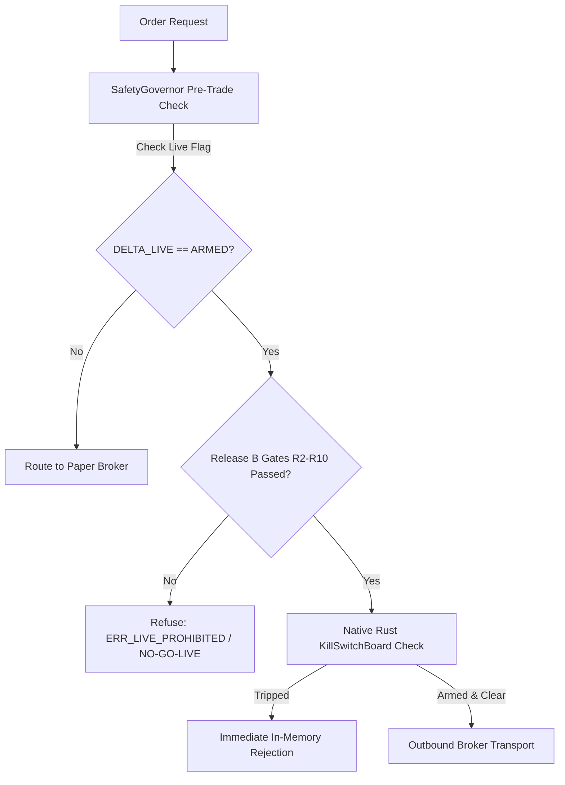

# DELTA OS — Venue & Asset Class Support Matrix

**Version**: `2.17.0`  
**Certification State**: `Release A (Private Research & Paper Beta)`  
**Live Trading Authority**: `FAIL-CLOSED / GATED (Release B: R2–R6, R8–R10 Pending)`  
**Audit Reference**: Consortium Architecture & Institutional Engineering Sign-Off  

---

## 1. Executive Summary

This document establishes the authoritative support matrix for venues and asset classes in DELTA OS. In strict accordance with the **Truth Over Polish** invariant (§1), all capabilities are partitioned across five functional dimensions:
1. **Live Data**: Real-time ticker, book, and quote ingestion.
2. **Historical Data**: Point-in-Time (PIT) backtest and walk-forward historical series.
3. **Quantitative Analytics**: Valuation, risk models, Greeks, regime clustering, and factor conditioning.
4. **Paper Trading**: Simulated lifecycle execution with realistic fill modeling, slippage, and ledger accounting.
5. **Live Execution**: Direct-to-broker / direct-to-exchange order routing with live capital.

> [!CAUTION]
> **Live capital execution is strictly gated (`NO-GO-LIVE`) across ALL asset classes.**  
> Any live execution attempt prior to fulfilling Release B quantitative gates (R2–R6, R8–R10) is rejected in-memory by `SafetyGovernor` and the native fail-closed kill board (`KillSwitchBoard`) with `ERR_LIVE_PROHIBITED`.

---

## 2. Institutional Venue & Asset Class Matrix

| Asset Class | Venues / Providers | Live Data | Historical Data | Quantitative Analytics | Paper Trading | Live Execution | Support Tier | Primary Enforcer / File Reference |
| :--- | :--- | :---: | :---: | :---: | :---: | :---: | :---: | :--- |
| **US Equities** | NYSE, NASDAQ, IEX (via Alpaca, Polygon, Yahoo, Paper Broker) | ✅ Supported | ✅ Supported (PIT Monotonic) | ✅ Supported (Alphas, Risk, Cost Engine) | ✅ Certified (`PaperBroker`, OMS Journal) | ❌ **BLOCKED / GATED** | `Tier 1: Supported` | [`execution/paper/broker.py`](file:///home/unknownuser/Delta/execution/paper/broker.py) [`data/market/calendar.py`](file:///home/unknownuser/Delta/data/market/calendar.py) |
| **International Equities** | LSE, Euronext, TSE, HKEX, NSE (via IBKR Client Portal REST API) | ⚠️ Partial (REST Snapshot) | ⚠️ Partial (EOD Historical) | ✅ Supported (Multi-Currency Risk & Calendars) | ✅ Certified (IBKR Paper Gateway & Simulation) | ❌ **BLOCKED / GATED** | `Tier 2: Partial` | [`execution/adapters/ibkr.py`](file:///home/unknownuser/Delta/execution/adapters/ibkr.py) [`data/market/international_calendars.py`](file:///home/unknownuser/Delta/data/market/international_calendars.py) |
| **Cryptocurrencies** | Coinbase Advanced, Binance (REST / WebSocket Public Feeds) | ✅ Supported (`TIER2_CRYPTO_LIVE`) | ⚠️ Partial (OHLCV Bars) | ✅ Supported (Satoshi Precision, Volatility) | ✅ Certified (`CryptoPaperBroker`) | ❌ **BLOCKED / GATED** | `Tier 2: Partial` | [`execution/adapters/crypto_paper.py`](file:///home/unknownuser/Delta/execution/adapters/crypto_paper.py) [`data/crypto/`](file:///home/unknownuser/Delta/data/crypto/) |
| **Equity & Index Options** | OPRA, CBOE (via BSM Analytics Engine) | ❌ Unsupported (No live OPRA feed) | ❌ Unsupported (No continuous vol surface DB) | ✅ Supported (BSM Price, Delta, Gamma, Vega, Theta, Rho) | ❌ Unsupported (No exercise / assignment engine) | ❌ **BLOCKED / GATED** | `Tier 3: Analytics-Only` | [`quant/derivatives/bsm.py`](file:///home/unknownuser/Delta/quant/derivatives/bsm.py) [`finance_model/financial_reasoner.py`](file:///home/unknownuser/Delta/finance_model/financial_reasoner.py) |
| **Futures** | CME, ICE, Eurex | ❌ Unsupported (No live tick feed) | ❌ Unsupported (No continuous back-adjusted series) | ⚠️ Partial (Futures Margin & Roll Decision Math) | ❌ Unsupported (No margin-call / physical delivery workflow) | ❌ **BLOCKED / GATED** | `Tier 3: Analytics-Only` | [`quant/derivatives/bsm.py`](file:///home/unknownuser/Delta/quant/derivatives/bsm.py) |
| **FX & Rates** | Interbank FX, SOFR / Treasury Curves | ❌ Unsupported | ❌ Unsupported | ❌ Unsupported (No discount curves or conventions) | ❌ Unsupported | ❌ **BLOCKED / GATED** | `Tier 4: Unsupported` | *Defect to claim execution capability until covered* |

---

## 3. Detailed Asset Class Specifications

### 3.1 US Equities (`Supported`)
- **Status**: Production-ready for research, backtesting, and paper trading.
- **Data Engine**: NYSE/NASDAQ calendar enforcement with sub-millisecond point-in-time monotonicity verification ($t_{event} \le t_{published} \le t_{available} \le t_{decision} \le t_{execution}$).
- **Paper Engine**: Full order lifecycle verified (`NEW`, `ACK`, `PARTIAL`, `FILLED`, `CANCELED`, `REJECTED`), non-mutating hash-chained audit journal (`RPO=0`), bid/ask spread slippage simulation, and 3-way reconciliation.
- **Live Gating**: Live execution is prohibited (`NO-GO-LIVE`) pending Release B statistical certification.

### 3.2 International Equities (`Partial`)
- **Status**: Multi-currency and multi-venue paper routing certified.
- **Contract Resolution**: IBKR Client Portal REST API resolution supporting over 150 global venues across North America, Europe, and Asia-Pacific.
- **Order Handling**: Automated interactive confirmation resolution (`/iserver/reply/{id}`) for price-deviation warnings and regulatory acknowledgements.
- **Limitations**: Real-time L2 market depth requires an active IBKR Gateway session. Live capital orders fail-closed unless explicit Release B gating is satisfied.

### 3.3 Cryptocurrencies (`Partial`)
- **Status**: Live market data and simulated execution certified.
- **Data Feeds**: TIER2 live ticker and orderbook ingestion for major pairs (BTC/USD, ETH/USD, SOL/USD) with strict URL-scheme validation (`https://`, `wss://` only; SSRF prevention).
- **Execution Simulation**: Dedicated `CryptoPaperBroker` supporting fractional quantities down to $10^{-8}$ satoshi precision, maker/taker fee tiers, and zero-slippage limit matching.
- **Limitations**: Live exchange API trading keys (HMAC-SHA256 signing) are fail-closed and prohibited in Release A.

### 3.4 Equity & Index Options (`Analytics-Only`)
- **Status**: Mathematical valuation and risk Greeks certified; order routing prohibited.
- **Analytics Engine**: Deterministic Black-Scholes-Merton (BSM) analytical pricer (`quant/derivatives/bsm.py`) backed by native Rust/C kernels and institutional-grade Python fallbacks.
- **AI Math Verifier**: Automated hallucination interception (`finance_model/financial_reasoner.py`) that audits LLM option price claims, calculates exact closed-form Greeks, and rectifies discrepancies $>0.5\%$.
- **Limitations**: No options contract chain master, no dividend surface interpolation, and no automatic exercise/assignment handling. Orders for option contracts are refused by the OMS.

### 3.5 Futures (`Analytics-Only`)
- **Status**: Margin calculation and contract roll helpers implemented; order routing prohibited.
- **Analytics Engine**: SPAN-style initial/maintenance margin estimation and calendar spread roll analysis.
- **Limitations**: No continuous contract stitching with backwardation/contango adjustment; no physical settlement or cash-settlement reconciliation. Futures orders are strictly blocked.

### 3.6 FX & Rates (`Unsupported`)
- **Status**: Unsupported.
- **Policy**: Any claim of FX trading or yield curve generation in marketing or TUI is classified as a documentation defect. No order routing is permitted.

---

## 4. Enforcement & Circuit Breakers

Every asset class is governed by the three-layer fail-closed safety stack:

1. **Layer 1: Safety Governor** ([`delta_os/safety.py`](file:///home/unknownuser/Delta/delta_os/safety.py)): In-memory token authentication, fat-finger size limits, notional limits, and kill-switch state checks.
2. **Layer 2: Release Gate Enforcer** ([`scripts/signoff.py`](file:///home/unknownuser/Delta/scripts/signoff.py)): Verifies cryptographic CI evidence and institutional gate sign-offs.
3. **Layer 3: Native Rust Kill Circuit** ([`tui/src/app.rs`](file:///home/unknownuser/Delta/tui/src/app.rs)): Hardware-level emergency stop that clears orders before network transmission.
